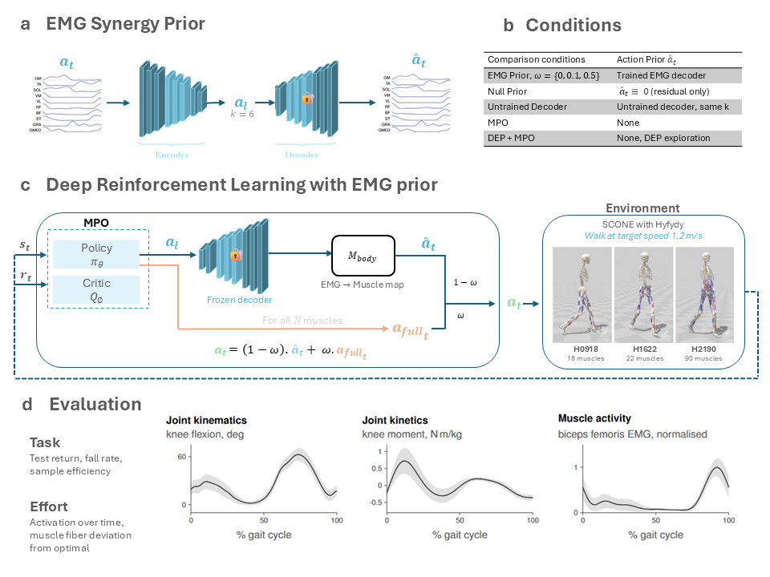
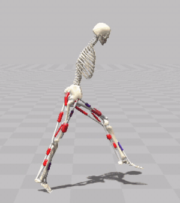
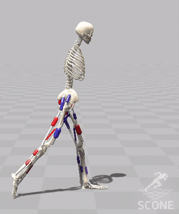
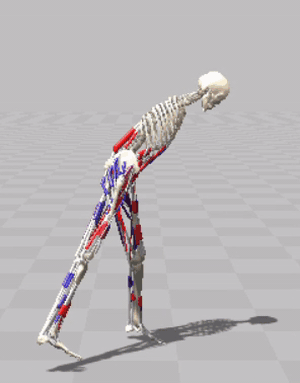
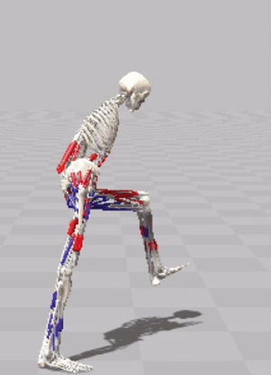
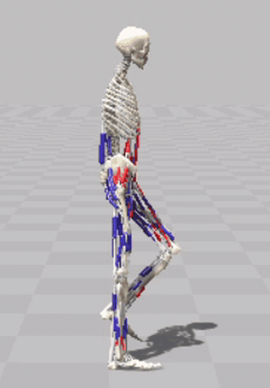

## Note: This code is being updated!

### Code accompanying *Learning Humanoid Locomotion from EMG-Based Latent Action Priors and Muscle Synergies*

📄 [Thesis](assets/thesis.pdf) | 🎞️ [Thesis defense slides](assets/thesis_defense.pptx)

A small autoencoder is trained on surface EMG from one human subject (Camargo et al. 2021). Its frozen decoder becomes part of the environment: the RL policy outputs a latent `z` plus a residual, and the decoder turns `z` into muscle excitations. It is evaluated with MPO and DEP-MPO on three musculoskeletal models in SCONE/Hyfydy: H0918 (2D, 18 muscles), H1622 (3D, 22) and H2190 (3D, 90).

| H0918 | H1622 | H2190 |
|:---:|:---:|:---:|
|  |  |  |

On H2190, compared with the baselines:

| DEP-MPO | MPO | LEAPS |
|:---:|:---:|:---:|
|  |  |  |

**How the prior works**: The decoder lives inside the environment (`src/leaps/envs/latent_env.py`), so MPO and DEP-MPO train on it without any change to the algorithms. The policy outputs a latent `z` and one residual per muscle. The decoder turns `z` into 11 EMG channels, which are mapped onto the model's muscles and blended with the residual as `(1 - w) * a_hat + w * a_full`. Muscles without a recorded EMG channel are driven by the residual alone. The right leg was recorded, and the left leg gets the same signal. The decoder is never updated during RL. As controls, the same wrapper can replace the decoder output with zeros (null prior) or use a decoder with random weights (untrained decoder).

**How to use this repository**: This repository uses `conda` to manage the python environment. Run `source setup.sh` to set up the repository; it also clones the [sconegym](https://github.com/la2pixel/sconegym) and [depRL](https://github.com/la2pixel/depRL) forks used here. `priors` contains the released EMG decoders and how they were trained. `src/leaps` contains the EMG preprocessing, the latent action prior wrapper, the config generator for the RL runs and the evaluation scripts; most steps run through the `leaps` command. For examples on how to train the decoders and run the experiments see `run.sh`. If you are getting started with this repository, you probably want to look at `run.sh`.

**Important**: You require [SCONE](https://scone.software) with a [Hyfydy](https://hyfydy.com) license to run the simulations. RL training only needs the decoders in `priors`; retraining them requires the [Camargo et al. 2021](https://doi.org/10.1016/j.jbiomech.2021.110320) dataset (`CAMARGO_DATA`). Experiments are logged to `wandb`.
